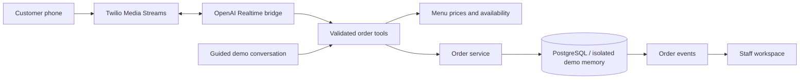

<div align="center">

# mei.ai

**From a phone conversation to a kitchen-ready pickup order.**

A restaurant ordering workspace with a voice-agent integration, menu validation, and a real-time staff dashboard.

[Try it locally](#try-the-product) · [Watch the walkthrough](#walkthrough) · [Voice provider evaluation](#voice-provider-evaluation) · [Architecture](docs/ARCHITECTURE.md) · [Deployment](docs/DEPLOYMENT.md)

</div>


## Why I built it

Taking phone orders interrupts the counter and the kitchen, especially during a rush. I saw this in my parents’ restaurant and wanted to build a better handoff: let an agent handle the conversation, validate the order against the menu, and give staff a clear queue they can act on.

This repository includes the voice integration and a self-contained product demo. The demo uses scripted calls and synthetic customers, so anyone can explore the workflow without a phone number or API keys.

## Try the product

### One command with Docker

```bash
docker compose -f compose.demo.yml up --build
```

Open **[localhost:4173](http://localhost:4173)**. No accounts, secrets, or database setup required.

### Run with Node.js 22

```bash
npm ci
npm --prefix apps/staff-web ci
npm run demo:build
npm run demo
```

Open **[localhost:4173](http://localhost:4173)**.

### A two-minute tour

1. **Start a sample call.** Choose a pickup order and advance the conversation, or use “Play call.”
2. **Confirm the order.** The backend checks menu availability and prices, then adds the order to the board.
3. **Run the kitchen.** Accept the order, start preparation, mark it ready, and complete it.
4. **Try an exception.** Choose an unavailable item or a request to speak with staff; inspect the recorded handoff.
5. **Explore the controls.** Change menu availability, set the restaurant to busy or closed, or open an order’s event timeline.

Every visitor gets a separate, temporary workspace. “Reset demo” restores the sample data. Conversations are simulated; order creation, validation, status transitions, session isolation, and event delivery run on the server.

### Run the staff dashboard with your own menu

The demo above uses a sample menu and simulated calls. To run the real order service, with a staff dashboard that phone agents send orders to:

```bash
npm ci && npm --prefix apps/staff-web ci
npm run build && npm run staff:web:build
MENU_FILE=data/menu.example.json INTERNAL_API_KEY=change-me-please npm start
```

Open **[localhost:3000/staff](http://localhost:3000/staff)** and sign in. Outside production the sample logins in `src/auth/config.ts` work; in production set `AUTH_USERS_JSON`, `JWT_SECRET` and `NODE_ENV=production`.

- **Menu file.** `MENU_FILE` points at a JSON file in the shape of [`data/menu.example.json`](data/menu.example.json): one entry per orderable thing, so each size or style ("Pint", "Quart", "Steamed") is its own item with its own id and price. A bad file stops startup. Without `MENU_FILE` the two-item sample menu is used.
- **Menu in the agent's context.** The phone agents get the whole menu in their instructions, grouped by section, so they can answer "what do you have?" without a lookup. Prices and totals still come from the server when the order is created.
- **Orders are kept in memory** unless `STORE_BACKEND=postgres` is set, so they are lost when the process restarts.
- **What callers can change.** `CHANGE_RULES_FILE` points at a JSON file in the shape of [`data/change-rules.example.json`](data/change-rules.example.json). Each rule covers any item, some menu sections, or some items, and lists changes that are allowed (free or with a price) and changes that are not. The agents get the rules in their instructions. An allowed change is ordered by its id, and the server checks it applies to that item and adds its price, so the model never sets a charge. A rule can also carry `guidance`: the restaurant's own sentences for open-ended requests, such as leaving an ingredient out or swapping a side, which a fixed list cannot cover. The agent follows them and writes the change in the item's note; guidance does not change the price. `unlisted_requests` decides whether a request no rule mentions is passed to the kitchen as a note or declined. The file is reread when it changes, so edits apply to the next call without a restart; an edit that leaves it invalid is logged and the last good rules stay in force.
- **Order texts.** On a Mac, set `ORDER_NOTIFY_IMESSAGE_TO` to a phone number or Apple ID and each new phone order is also sent as an iMessage from that Mac's Messages app, which must be signed in. macOS asks once for permission to let the server control Messages; until that is allowed, sends time out and are logged as `order_notify_failed`. A failed text never blocks the order.
- **Other settings.** `HOST` limits the listening interface. `OPENAI_API_KEY_FILE` and `OPENAI_WEBHOOK_SECRET_FILE` read those keys from files instead of the environment.

## Walkthrough


[Download the silent video](docs/images/walkthrough.webm) · Recorded from the running application.

## The workspace

| Orders | Calls | Restaurant controls |
| --- | --- | --- |
| New → preparing → ready → completed | Guided pickup, unavailable-item, and human-handoff scenarios | Menu availability, open/busy/closed status, and pickup estimates |
| Itemized receipts and order timelines | Explicit confirmation before submission | Prices calculated from the restaurant menu |
| Automatic updates with polling fallback | Retry-safe order creation | Responsive desktop and mobile layouts |

<details>
<summary><strong>See the call-to-order workflow</strong></summary>


</details>

<details>
<summary><strong>See menu availability controls</strong></summary>


</details>

## How it works



**The model does not decide prices.** Order tools submit item IDs and quantities; server-side menu data determines availability and totals.

**Retries should not become extra orders.** Voice orders use a stable per-call identity. The repositories enforce idempotency, and the regression suite checks that repeated submissions produce one order and one creation event.

**Staff control the workflow.** Allowed status transitions live in the repository layer. Each change leaves an event trail. The existing staff application supports WebSocket delivery and replay; the isolated demo uses server-sent events with a polling fallback.

**The demo is isolated by construction.** It creates an in-memory repository per visitor and never connects to Twilio, OpenAI, or a production database. Sessions expire after 30 minutes and server capacity is bounded.

[Read the architecture and tradeoffs →](docs/ARCHITECTURE.md)

## Voice provider evaluation

I put four voice stacks behind the same phone number and placed real calls to each one. Every stack got the same system prompt, the same three order tools (store status, menu search, create order), and the same scripted order: one chicken burrito, give a name, decline extras, confirm.

**Status: a first hands-on pass, not a benchmark.** Nine calls in total, one caller, one mobile phone, English only, a two-item sample menu. Treat the numbers as observations.

### Result

| Stack | How the call reaches it | Calls | Order completed | Greeting | Ends the call itself |
| --- | --- | --- | --- | --- | --- |
| OpenAI GPT-Live (`gpt-live-1.1`, tools delegated to a backend model) | SIP from the carrier to OpenAI | 3 | 1 | Clean on the two calls that connected | No |
| OpenAI Realtime (`gpt-realtime-2.1`, default session settings) | SIP from the carrier to OpenAI | 3 | 1 | Cut itself off on every call | Yes |
| ElevenLabs Agents (Gemini 3.5 Flash, Turbo v2 speech) | SIP trunk from the carrier to ElevenLabs | 2 | 1 | Clean | Yes |
| Cloudflare Agents voice (Flux speech-to-text, `gpt-oss-120b`, Aura 2 speech) | Carrier audio stream into a Worker | 1 | 0 | Never played | n/a |

Timing and cost on each stack's completed call (65 to 75 seconds long):

| Stack | Caller stops to agent starts, plain turns | "Yes, correct" to "your order is placed" | Approximate cost of the call |
| --- | --- | --- | --- |
| GPT-Live | 0.4 to 0.8 s ¹ | about 7 s, with filler speech | $0.06 session, plus about 13,600 backend input tokens |
| Realtime | 0.5 to 1.2 s ¹ | 4.4 s, with filler speech | about $0.11 audio, plus text tokens |
| ElevenLabs | 1.2 to 1.9 s ² | 2.6 s, silent | about $0.09 platform, plus $0.03 model |

¹ Measured by this repo's recorder from transcript events, which run optimistic. ² Measured by ElevenLabs at the audio level. The two methods are not directly comparable. Costs come from each provider's reported usage and list prices, exclude the carrier (about $0.006 for a two-minute call), and were not checked against an invoice.

### What went wrong, and whose fault it was

Six of the nine calls did not end in an order. Most of those failures were mine, not the provider's.

| Call | What the caller experienced | Cause |
| --- | --- | --- |
| GPT-Live, first call | "I'm having trouble pulling up the menu" | **This repo.** Menu search matched item names only, so searching for "menu" returned nothing. Fixed: an empty search lists the menu. |
| GPT-Live, third call | Silence; OpenAI closed the session as expired after 30 s | **Unknown.** The call was accepted and no audio was ever exchanged. |
| Realtime, all three calls | The agent stops mid-sentence and starts over | **Provider defaults plus line echo.** The agent's own voice came back on the caller's leg and was treated as the caller speaking. One call still finished the order; two did not. Noise reduction and less sensitive speech detection are untested. |
| ElevenLabs, first call | "I'm having trouble accessing our menu" | **This repo.** The order API behind the tools was down; every tool call returned 502. |
| Cloudflare | Silence, apart from one short line | **This build.** Replies took 3 to 13 s to prepare and any caller speech cancelled the reply in progress, so the caller's "Hello?" kept cancelling them. |

### What I take from it

- **All three hosted speech stacks can take this order.** The differences showed up in the edges: GPT-Live never hung up, Realtime needs echo handling before it is usable on a phone, and ElevenLabs was the only one that was clean from greeting to hang-up but was also the slowest to start speaking.
- **Tool design decided more calls than model choice.** Two failed calls came from a search tool the model could not use to answer "what do you have?" and from the tools' backend being down.
- **A speech-to-text, model, text-to-speech pipeline needs real engineering to be usable.** As built here, the Cloudflare pipeline is too slow for a phone call. A pre-made greeting, sentence-by-sentence speech and a faster model are the obvious next steps, none of them done.
- **The cheapest line item was the carrier.** Provider cost per one-minute order landed between roughly $0.06 and $0.12 before unverified token charges.

### What this does not cover

Order accuracy on a real menu, modifiers and corrections ("make that two"), background noise, Mandarin or Cantonese, callers other than me, concurrent calls, and transfer to staff. Per-call records are kept locally and not published because they contain caller details.

### Code

| Path | What it is |
| --- | --- |
| `src/voice/openai-sip/` | Verifies OpenAI's incoming-call webhook, accepts the call as GPT-Live or Realtime, runs the order tools, and ends or transfers the call |
| `src/voice/call-recorder.ts` | Per-call record: transcripts, tool timings, response gaps, usage |
| `infra/elevenlabs/setup-test-agent.mjs` | Creates the ElevenLabs test agent and its three webhook tools |
| `infra/cloudflare-voice/` | Cloudflare Worker: voice agent plus a carrier audio-stream adapter, with a call simulator in `test/` |
| `infra/line-check/` | Minimal Worker that answers a call with a spoken confirmation, for testing the carrier leg alone |

## Stack

| Layer | Technology |
| --- | --- |
| Voice integration | Twilio, OpenAI Realtime, audio conversion |
| Backend | Node.js 22, TypeScript, Express, Zod |
| Staff UI | React, Vite, TypeScript |
| Persistence | PostgreSQL, repository abstraction, order events and outbox |
| Checks | Vitest, Supertest, Playwright, GitHub Actions |
| Packaging | Docker multi-stage builds and Compose |

## Verification

```bash
npm run ci                 # lint, backend types/tests/build, staff types/tests/build
npm run demo:test:e2e       # browser workflow tests; build the demo first
npm run test:integration    # requires an isolated disposable PostgreSQL database
```

Install the browser once with `npm --prefix apps/staff-web exec playwright install chromium`.

The test suite covers order retries, menu validation, staff transitions, session isolation/expiry, and browser workflows. PostgreSQL integration and the demo container have also been exercised locally. See the [dated verification report](docs/VERIFICATION.md) for exact results and boundaries.

## Deployment modes

| Mode | What is included | What you configure |
| --- | --- | --- |
| **Product demo** | Complete UI, isolated synthetic workspaces, shared order logic, event stream | One container; HTTPS/reverse proxy for a public host |
| **Voice integration** | Twilio endpoints, audio bridge, model tools, staff API, PostgreSQL/outbox path | Provider accounts, phone routing, secrets, database, staff credentials, and live-call validation |

The product demo is packaged for deployment. The provider-backed phone integration is a separate path. The original Twilio audio bridge targets an OpenAI interface that has since been shut down and is **not validated**. The newer SIP paths have only been exercised on the handful of test calls in the [voice provider evaluation](#voice-provider-evaluation). Do not route customer calls to either based on the demo checks alone. The demo’s handoff records an event; it does not place a real transfer.

[Deployment guide →](docs/DEPLOYMENT.md) · [Environment template](.env.example)

## Repository map

```text
src/demo/                 Isolated demo sessions, API, and server
src/workers/call-*.ts      Voice session, audio bridge, prompt, and tools
src/menuOrder.ts           Shared menu validation and price calculation
src/orderService.ts        Order operations
src/store/                 Memory and PostgreSQL repositories
apps/staff-web/src/demo/   Product demonstration workspace
apps/staff-web/src/App.tsx Original authenticated staff application
tests/                    Backend and database checks
apps/staff-web/e2e/        Browser workflows
docs/                     Architecture, deployment, and verification
```

Built by [Ivan Chen](https://github.com/ichen27). See [CONTRIBUTING.md](CONTRIBUTING.md) for development instructions.
